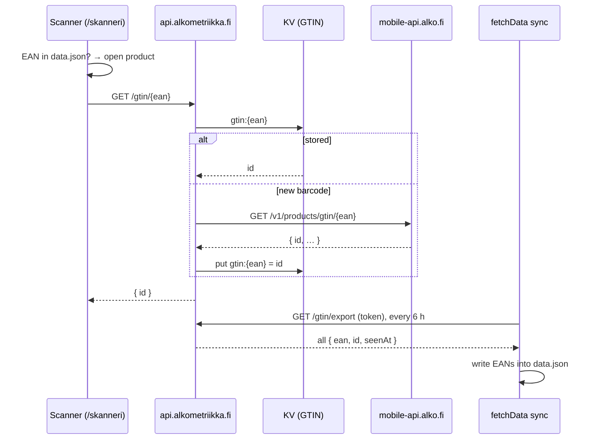

# API Worker (`api.alkometriikka.fi`)

The site is static, so this Cloudflare Worker (`workers/api/`) is its only server-side code. It
does two things:

- It tells the [scanner](frontend/features.md#scanner-skanneri) which Alko product a barcode
  belongs to (the rest of this page up to [Live store availability](#live-store-availability)).
- It gives product pages the [live unit count](#live-store-availability) of each store.

## Why it exists

Alko's web API, which the [sync](data/sync-pipeline.md) reads, has no EANs. Alko's Android app
can look a barcode up, but only through its own backend:

```
GET https://mobile-api.alko.fi/v1/products/gtin/{ean}?lang=fi
x-api-key: <the key built into the app>
```

The answer is the product's full details, including `id` (the product number). It doesn't
include the barcode itself, so there's no way to fetch every product's EAN up front. The Worker
learns them one scan at a time instead, and the sync copies what it has learned into `data.json`.

The key is hardcoded in the APK (`fi.alko.mobile`), so every install sends the same one. The key
isn't ours and the endpoint isn't public. Alko can change or block it at any time, and then the
scanner falls back to the EANs already in `data.json`. Keep it out of the client bundle and the
repository: it's a Worker secret only.

## Flow



## Endpoints

| Endpoint                 | Auth                                   | Answer                                                                                                                                     |
| ------------------------ | -------------------------------------- | ------------------------------------------------------------------------------------------------------------------------------------------ |
| `GET /gtin/{ean}`        | none, rate limited                     | `200 { id }`, `404` if Alko doesn't know it, `400` for an invalid code (length or check digit), `429` over the limit, `502` if Alko failed |
| `GET /gtin/export`       | `Authorization: Bearer <EXPORT_TOKEN>` | `200 { entries: [{ ean, id, seenAt }] }`, every stored barcode                                                                             |
| `GET /availability/{id}` | none, rate limited                     | `200 { fetchedAt, counts: { storeId: count } }`, `400` for an invalid product number, `429` over the limit, `502` if Alko failed           |

- Lookups send `Access-Control-Allow-Origin: *`. A product number is public, so CORS doesn't need
  to guard anything. The rate limit is what protects Alko from being scraped through us.
- Only the product number goes back to the browser, never the rest of Alko's payload.
- Found answers are cacheable for a day. A barcode Alko doesn't know is kept in the edge cache
  for a day (not in KV), so repeated scans of it don't reach Alko.
- A mapping older than 90 days is checked with Alko again in the background (`ctx.waitUntil`),
  in case the product was renumbered. The stored answer is returned meanwhile.

## Storage and limits

- **KV namespace `GTIN`**: key `gtin:{ean}`, value the product number, metadata `{ id, seenAt }`.
  The metadata is what `/gtin/export` reads, as a KV listing returns it without one read per key.
  Only new barcodes are written, so the free tier's 1,000 writes a day is plenty.
- **Rate limit `LOOKUP_LIMITER`**: 30 lookups a minute per IP. It only counts lookups that would
  reach Alko; stored ones are free.
- Entries stay in KV after the sync has copied them, so the export is idempotent and a failed
  sync loses nothing.

## The sync

`scripts/data/scanned-eans.ts`. The sync fetches the export in parallel with Alko's API, using
`GTIN_EXPORT_URL` and `GTIN_EXPORT_TOKEN`. When either is unset (locally) or the export fails, it
logs a warning and keeps the EANs it has. After the passes, `applyScannedEans` writes each barcode
into its product's `EAN` column:

- A scanned barcode replaces a different EAN already stored (legacy XLSX data or an earlier scan):
  the Worker's answer is the newer one.
- When one product has several scanned barcodes (a bottle and a gift box, say), the first one seen
  is stored. The Worker still answers the others.
- New or changed EANs count as a change, so `LastUpdated` moves.
- `cleanEans` then empties EANs that can't identify a product: values that aren't a valid GTIN, the
  all-zero placeholder, and barcodes shared by several products (the legacy list reuses one across
  a producer's vintages). A scanned barcode that confirms one of the sharing products lets that one
  keep it.

The API never fills `EAN`, so it's listed in `OWN_COLUMNS` (`constants.ts`), and
`carryOwnColumns` keeps the stored value when pass 2 or 3 rebuilds a product from the API. `EAN`
isn't hashed, so filling it in doesn't trigger detail fetches or new OG images.

## Live store availability

`availability.json` comes from the sync's search sweep, so it says which stores had a product at
the last sync (up to 6 hours ago) and nothing about how many units. Alko's product page asks a
per-product endpoint for that:

```
GET https://www.alko.fi/api/product-api/availability/{id}
User-Agent: <a browser's; 403 without one>
```

It answers every store stocking the product with its unit `count`, plus each store's address and
two weeks of opening hours: ~200 KB, ~0.35 s. It has no CORS headers, and an unknown product
answers `[]` like one no store has. The Worker fetches it, keeps only `{ storeId: count }` for
stores with units (pickup points, `outletType` `"2"`, dropped like in `availability.json`), and
returns ~3 KB.

- **Edge cache, not KV.** The trimmed answer goes into `caches.default` under
  `/availability/__counts/{id}`. KV's free tier allows 1,000 writes a day, and refreshing even a
  hundred products every 15 minutes would take ten times that; the Cache API is free and unmetered.
  It is per data centre, but Finnish visitors mostly land on the same one or two.
- **Fresh for 15 minutes** (`AVAILABILITY_FRESH_S`). Browsers may reuse an answer for up to 5
  minutes of that.
- **Stale for up to 6 hours** (`AVAILABILITY_STALE_S`). An older answer is still returned at once
  while a background refresh (`ctx.waitUntil`) fetches a new one, and keeps being returned while
  Alko fails or the IP is over its limit. After 6 hours the cache drops it.
- **Failures** are cached for a minute (`/availability/__error/{id}`): a product with nothing
  cached answers `502` without asking Alko again, so an Alko outage isn't hammered.
- **Rate limit `AVAILABILITY_LIMITER`**: 30 a minute per IP, counting only requests that would
  reach Alko (a miss or a stale refresh). Over it, a stale answer is still served, without a
  refresh.

Parsing Alko's answer is the only real CPU work, under a millisecond of the free plan's 10 ms,
and only on a miss or refresh. Each product page view that reaches the section is one Worker
request (of the free plan's 100,000 a day, shared with `/gtin`).

On the site, the product view (`views/Product.svelte`) asks for the counts (`loadLiveAvailability`,
`src/lib/utils/catalog/liveAvailability.ts`) and shares them between the price box and the store
list. With a preferred store chosen it asks right away, as the price box near the top shows that
store ("Saatavilla valitusta myymälästä · N kpl", or the nearest store that has it with its count).
Without one it asks only once the store list is 400 px from the viewport, so those views that never
scroll there cost nothing. Until the counts arrive, or if they don't, both show `availability.json`.
Once they do, they decide which stores have the product, each listed store shows "Saatavilla N kpl",
and "päivitetty" is the counts' `fetchedAt`.

The [MCP server](../README.md#mcp-server) is the Worker's other caller: `lookup_barcode` asks
`/gtin/{ean}` and `store_availability` asks `/availability/{id}` (`mcp/live.ts`), keeping answers
for as long as the site does.

## Setup and deploy

Wrangler isn't a dependency; run it with `bunx`. From the repository root:

```sh
bunx wrangler@4 login
bunx wrangler@4 kv namespace create GTIN   # paste the id into workers/api/wrangler.jsonc
bunx wrangler@4 secret put ALKO_API_KEY -c workers/api/wrangler.jsonc
openssl rand -hex 32 | tee /dev/stderr | bunx wrangler@4 secret put EXPORT_TOKEN -c workers/api/wrangler.jsonc
bunx wrangler@4 deploy -c workers/api/wrangler.jsonc
```

The deploy creates the `api.alkometriikka.fi` custom domain (DNS record and certificate) in the
`alkometriikka.fi` zone. Then add the same export token to the repository as the
`GTIN_EXPORT_TOKEN` secret (see [CI/CD](ci-cd.md#secrets-and-variables)).

A WAF custom rule in the zone ("Block: … anything but GET/OPTIONS /gtin/\* and /availability/\* on
api") blocks every other path on `api.alkometriikka.fi` before it reaches the Worker, so bots
probing random paths don't use Worker requests. **A new route has to be added to that rule**, or
it answers Cloudflare's 403 "Sorry, you have been blocked" page. The zone's managed challenges
(Asia, datacenter ASNs) also apply to the API; a challenged browser gets a 403 and the site falls
back as it does for any failure.

Logs: `bunx wrangler@4 tail -c workers/api/wrangler.jsonc`, or Workers observability in the
Cloudflare dashboard. A `502` with "status 401" or "status 403" in the log means Alko no longer
accepts the key. Get the current one from a newer APK.

Tests: `tests/workers/api.test.ts` runs the Worker against an in-memory KV and a mocked Alko.

## Local development

Run the Worker locally, then point the dev site at it:

```sh
bunx wrangler@4 dev -c workers/api/wrangler.jsonc --local --port 8787
echo 'VITE_API_ORIGIN=http://localhost:8787' > .env.development   # gitignored; only `vite dev` reads it
bun run dev:no-sync
```

`--local` simulates KV, the rate limiters and the edge cache, so nothing touches the deployed
Worker's state, but requests do reach Alko's real endpoints. `/availability/{id}` needs no secrets;
`/gtin/{ean}` needs `ALKO_API_KEY` in `workers/api/.dev.vars` (gitignored) to answer anything other
than `502`. Remove `.env.development` (or the line) to use the production Worker again.
