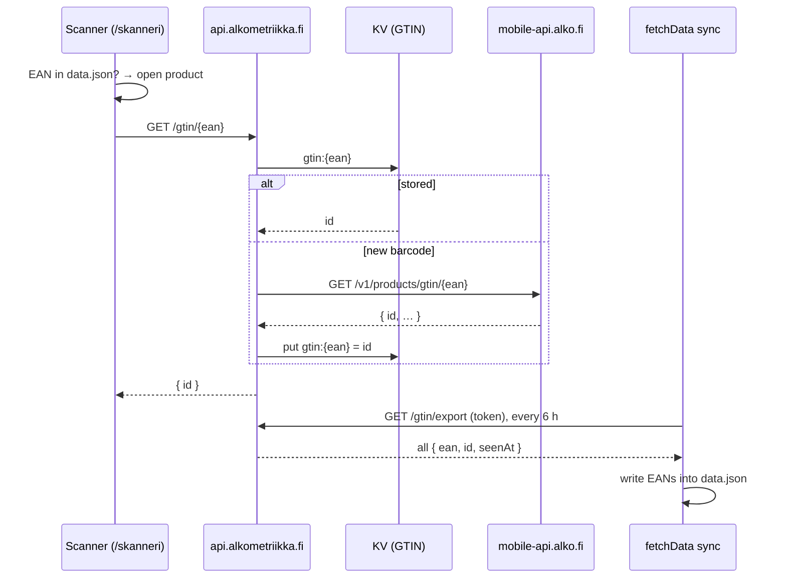

# API Worker (`api.alkometriikka.fi`)

The site is static, so this Cloudflare Worker (`workers/api/`) is its only server-side code. For
now it does one thing: it tells the [scanner](frontend/features.md#scanner-skanneri) which Alko
product a barcode belongs to.

## Why it exists

Alko's web API, which the [sync](data/sync-pipeline.md) reads, has no EANs. Alko's Android app
can look a barcode up, but only through its own backend:

```
GET https://mobile-api.alko.fi/v1/products/gtin/{ean}?lang=fi
x-api-key: <the key built into the app>
```

The answer is the product's full details, including `id` (the product number). It doesn't
include the barcode itself, so there's no way to fetch every product's EAN up front. The Worker
learns them one scan at a time instead, and the sync copies what it has learned into `data.json`.

The key is hardcoded in the APK (`fi.alko.mobile`), so every install sends the same one. The key
isn't ours and the endpoint isn't public. Alko can change or block it at any time, and then the
scanner falls back to the EANs already in `data.json`. Keep it out of the client bundle and the
repository: it's a Worker secret only.

## Flow



## Endpoints

| Endpoint           | Auth                                   | Answer                                                                                                                                     |
| ------------------ | -------------------------------------- | ------------------------------------------------------------------------------------------------------------------------------------------ |
| `GET /gtin/{ean}`  | none, rate limited                     | `200 { id }`, `404` if Alko doesn't know it, `400` for an invalid code (length or check digit), `429` over the limit, `502` if Alko failed |
| `GET /gtin/export` | `Authorization: Bearer <EXPORT_TOKEN>` | `200 { entries: [{ ean, id, seenAt }] }`, every stored barcode                                                                             |

- Lookups send `Access-Control-Allow-Origin: *`. A product number is public, so CORS doesn't need
  to guard anything. The rate limit is what protects Alko from being scraped through us.
- Only the product number goes back to the browser, never the rest of Alko's payload.
- Found answers are cacheable for a day. A barcode Alko doesn't know is kept in the edge cache
  for a day (not in KV), so repeated scans of it don't reach Alko.
- A mapping older than 90 days is checked with Alko again in the background (`ctx.waitUntil`),
  in case the product was renumbered. The stored answer is returned meanwhile.

## Storage and limits

- **KV namespace `GTIN`**: key `gtin:{ean}`, value the product number, metadata `{ id, seenAt }`.
  The metadata is what `/gtin/export` reads, as a KV listing returns it without one read per key.
  Only new barcodes are written, so the free tier's 1,000 writes a day is plenty.
- **Rate limit `LOOKUP_LIMITER`**: 30 lookups a minute per IP. It only counts lookups that would
  reach Alko; stored ones are free.
- Entries stay in KV after the sync has copied them, so the export is idempotent and a failed
  sync loses nothing.

## The sync

`scripts/data/scanned-eans.ts`. The sync fetches the export in parallel with Alko's API, using
`GTIN_EXPORT_URL` and `GTIN_EXPORT_TOKEN`. When either is unset (locally) or the export fails, it
logs a warning and keeps the EANs it has. After the passes, `applyScannedEans` writes each barcode
into its product's `EAN` column:

- A product that already has an EAN keeps it (legacy XLSX data or an earlier scan).
- When one product has several scanned barcodes (a bottle and a gift box, say), the first one seen
  is stored. The Worker still answers the others.
- New EANs count as a change, so `LastUpdated` moves.

The API never fills `EAN`, so it's listed in `OWN_COLUMNS` (`constants.ts`), and
`carryOwnColumns` keeps the stored value when pass 2 or 3 rebuilds a product from the API. `EAN`
isn't hashed, so filling it in doesn't trigger detail fetches or new OG images.

## Setup and deploy

Wrangler isn't a dependency; run it with `bunx`. From the repository root:

```sh
bunx wrangler@4 login
bunx wrangler@4 kv namespace create GTIN   # paste the id into workers/api/wrangler.jsonc
bunx wrangler@4 secret put ALKO_API_KEY -c workers/api/wrangler.jsonc
openssl rand -hex 32 | tee /dev/stderr | bunx wrangler@4 secret put EXPORT_TOKEN -c workers/api/wrangler.jsonc
bunx wrangler@4 deploy -c workers/api/wrangler.jsonc
```

The deploy creates the `api.alkometriikka.fi` custom domain (DNS record and certificate) in the
`alkometriikka.fi` zone. Then add the same export token to the repository as the
`GTIN_EXPORT_TOKEN` secret (see [CI/CD](ci-cd.md#secrets-and-variables)).

Logs: `bunx wrangler@4 tail -c workers/api/wrangler.jsonc`, or Workers observability in the
Cloudflare dashboard. A `502` with "status 401" or "status 403" in the log means Alko no longer
accepts the key. Get the current one from a newer APK.

Tests: `tests/workers/api.test.ts` runs the Worker against an in-memory KV and a mocked Alko.
