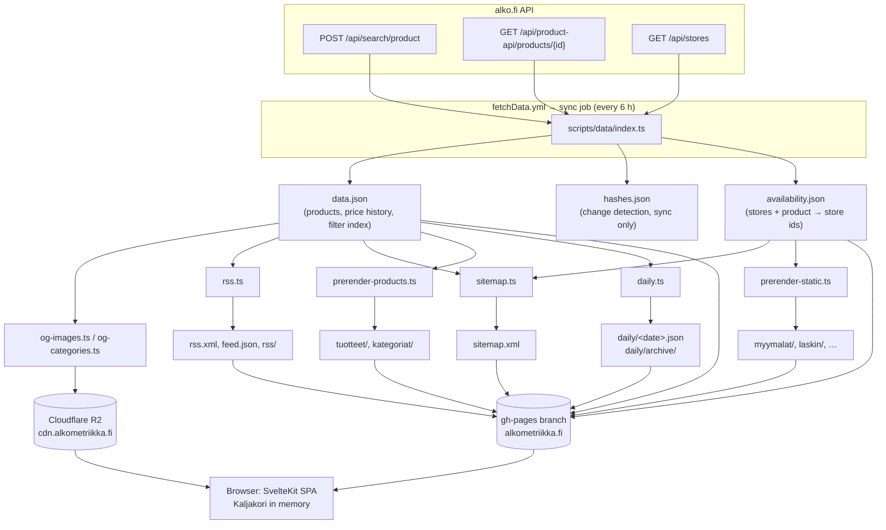
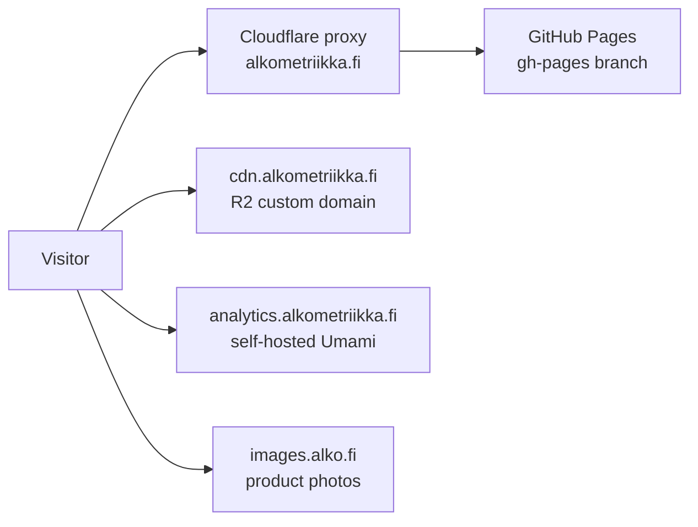

# Architecture

Alkometriikka is a static site with no application server. Everything a visitor sees is either
a static file on GitHub Pages, an image on Cloudflare R2, or computed in the browser from two
JSON files. A set of GitHub Actions workflows keeps those files fresh.

## The moving parts

| Part              | Where it lives                             | What it does                                                                                         |
| ----------------- | ------------------------------------------ | ---------------------------------------------------------------------------------------------------- |
| Data sync         | `scripts/data/`                            | Fetches Alko's API every 6 hours, writes `data.json`, `hashes.json` and `availability.json`          |
| SvelteKit app     | `src/`                                     | Client-rendered SPA. Downloads `data.json` and does all searching, filtering and math in the browser |
| Daily game baker  | `scripts/site/daily*.ts`, `src/lib/daily/` | Pins each day's quiz to a JSON manifest and archives finished days                                   |
| Prerender scripts | `scripts/site/prerender-*.ts`              | Writes an HTML stub per product, category, store and static page so crawlers see real metadata       |
| Feeds and sitemap | `scripts/site/rss.ts`, `sitemap.ts`        | `rss.xml`, `feed.json`, per-product and per-category RSS, `sitemap.xml`                              |
| OG image renderer | `scripts/og/`                              | Renders 1200×630 share cards with satori + resvg and uploads them to R2                              |
| Workflows         | `.github/workflows/`                       | Glue: test, build, sync, render, deploy, archive                                                     |

## Data flow



1. The **sync** sweeps Alko's search API (~11 000 active products in pages of 1000), hashes a few
   fields per product, and fetches the detail API only for products whose hash changed. See
   [Sync pipeline](data/sync-pipeline.md).
2. The same workflow run renders **OG images** for changed products, builds the **sitemap** and
   **feeds**, bakes the **Daily** manifests, regenerates the **prerendered stubs**, and commits
   everything to `gh-pages`. See [CI/CD](ci-cd.md).
3. A visitor's browser loads the SPA shell, fetches `data.json` (about 1.3 MB gzipped) and
   `availability.json`, and builds a [`Kaljakori`](frontend/kaljakori.md) from them. Every page
   works off that in-memory catalog.

## Hosting



- **GitHub Pages** serves the `gh-pages` branch. The `CNAME` file points it at `alkometriikka.fi`.
  The branch is not built from `main` directly: workflows assemble it and push to it.
- **Cloudflare** sits in front of the domain. The workflows purge specific URLs
  (`data.json`, `availability.json`, `rss.xml`, `feed.json`, `notices.json`,
  `daily/archive/index.json`) after pushing to `gh-pages` so visitors don't get a stale edge copy.
- **Cloudflare R2** (bucket `alkometriikka-og`, custom domain `cdn.alkometriikka.fi`) holds the OG
  share images and a tarball backup of the Daily archive. Images are content-addressed, so a
  Cloudflare Cache Rule serves them as immutable.
- **Alko's image CDN** (`images.alko.fi`) serves product photos directly to the browser. OG
  images fall back to it when no rendered card exists.

## Why a client-rendered SPA

`svelte.config.js` uses `@sveltejs/adapter-static` with `fallback: '404.html'`, and
`src/routes/+layout.ts` sets `ssr = false` and `prerender = false`. Any URL that has no file on
`gh-pages` is served `404.html`, which boots the SPA and routes client-side.

That keeps hosting free and simple, but crawlers and link-preview bots don't run JavaScript. The
prerender scripts fix that by writing a real `index.html` for every indexable URL, containing the
page's title, description, Open Graph tags, JSON-LD and a plain-HTML fallback body. The SPA boots
from the same file and removes the fallback. See [Site generation](site-generation.md#prerendered-stubs).

## Repository layout

```
.github/
  workflows/          build.yml, fetchData.yml, archiveDaily.yml, test.yml
  actions/            composite actions shared by the workflows
docs/                 this documentation
notes/                design notes and investigations (historical)
schemas/              JSON schema for static/notices.json
scripts/
  bench/              load-performance benchmark
  data/               the sync, dataset I/O, lifecycle rules, safeguards, one-off migrations
  lib/                small shared helpers (CLI args, HTML escaping, stub rendering, pools)
  og/                 OG image rendering (products, categories, Daily)
  r2/                 R2 S3 client and maintenance CLI
  site/               Daily baker, prerender scripts, RSS, sitemap, archive backup
src/
  app.html            page shell, loader animation, analytics tags, SEO markers
  app.css             Tailwind v4 theme and utilities
  lib/alko/           Kaljakori and lazy store availability
  lib/components/     views/, product/, category/, widgets/, inputs/
  lib/daily/          Daily game generator, manifest, scoring, storage
  lib/utils/          everything else (filters, metrics, sales, SEO copy, storage…)
  routes/             SvelteKit routes
static/               files copied as-is into the build (manifest, icons, notices.json…)
tests/                bun:test suites, mirroring scripts/ and src/lib/
```

Several modules under `src/lib/utils/` (`categories.ts`, `seo.ts`, `sales.ts`, `food.ts`,
`number.ts`, `dataset.ts`) are imported by the Bun scripts as well as the app. They avoid `$lib`
imports and browser globals so both sides share one implementation of slugs, SEO copy, sale
detection and dataset parsing.
