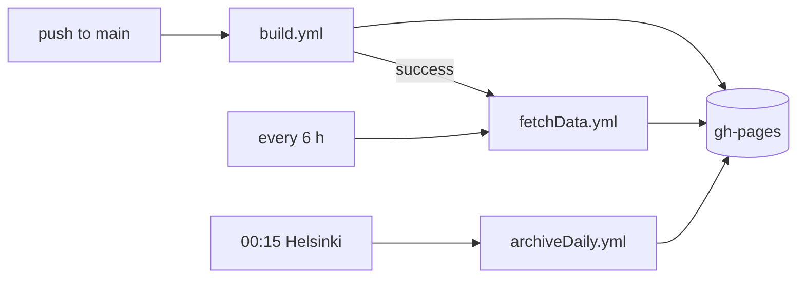
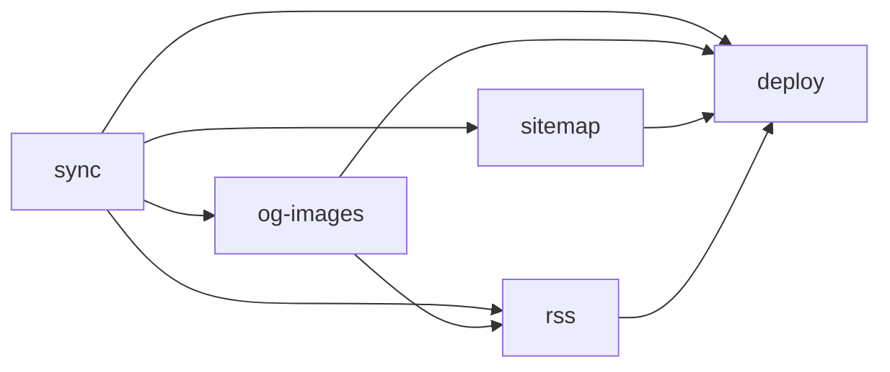

# CI/CD

All automation is GitHub Actions. There are four workflows and seven composite actions.

| Workflow           | Name in the UI                          | Triggers                                                                             |
| ------------------ | --------------------------------------- | ------------------------------------------------------------------------------------ |
| `test.yml`         | Test                                    | Pull requests, pushes to branches other than `main`                                  |
| `build.yml`        | Build and move files to gh-pages branch | Pushes to `main`                                                                     |
| `fetchData.yml`    | Download Price List                     | Every 6 hours, after a successful build, manually (with an optional **force** input) |
| `archiveDaily.yml` | Archive Finished Daily Games            | 21:15 and 22:15 UTC daily, manually                                                  |

`build.yml`, `fetchData.yml` and `archiveDaily.yml` share the concurrency group
`gh-pages-deployment` without cancellation, so they queue up instead of racing each other on the
`gh-pages` branch.



## The `gh-pages` branch

`gh-pages` is the deployed site and the only place runtime data lives. Workflows seed their
working copies from it, so it is effectively the database.

```
/                      404.html (SPA shell), index.html (front page stub), _app/ (JS/CSS),
                       service-worker.js,
                       static/ files, CNAME, .nojekyll
data.json              dataset (fetchData)
hashes.json            change-detection hashes (fetchData)
availability.json      stores and stock (fetchData)
og-images.json         product OG manifest (fetchData)
og-categories.json     category OG manifest (fetchData)
sitemap.xml            (fetchData)
rss.xml, feed.json     aggregate feeds (fetchData)
rss.{en,sv}.xml, feed.{en,sv}.json   aggregate feeds in English and Swedish (fetchData)
labels.{en,sv}.json    English and Swedish value translations (fetchData)
rss/                   per-product and per-category feeds (fetchData)
tuotteet/              product stubs (build + fetchData)
tuotteet-manifest.json prerender keys (build + fetchData)
kategoriat/            category stubs (build + fetchData)
myymalat/, laskin/, tilastot/, kompassi/, hinnanmuutokset/   static stubs (build + fetchData)
daily/                 manifests, index.html stub, archive/ (fetchData + archiveDaily)
notices.json           site notices (build, from static/)
```

The runtime files are gitignored on `main`, so every workflow that writes `gh-pages` force-adds
them with `git add -f`.

## `test.yml`

Runs `bunx svelte-kit sync && bun test`, then `bun run check` (svelte-check for `src`,
`tsc -p scripts` for `scripts`). Cancels in-progress runs for the same ref. `main` isn't tested here
because `build.yml` tests before deploying.

## `build.yml`

Deploys a new version of the app. The site code changes, but the data must not.

1. Run the full test suite.
2. **Seed** `static/` with the deployed `data.json`, `availability.json`, `og-images.json` and
   `og-categories.json`, so the build copies them into `build/`.
3. `vite build` with `BASE_PATH=''`, then minify the vendored `auto-events.js` in the output.
4. **Prerender gate**: compare `data.json`, `404.html` and `og-images.json` in `build/` with the
   deployed ones. If all three are byte-identical, product pages don't need regenerating.
5. **Restore** the deployed `tuotteet/`, `tuotteet-manifest.json` and `kategoriat/` into `build/`,
   so unchanged product pages carry over and the incremental prerender can skip them.
6. **Restore** the deployed `daily/` into `build/`, migrating old archive folder names. If it can't
   be restored the build **fails**, because a deploy without it would let the next bake re-roll
   games in progress.
7. Prerender product and category pages if the gate said so. Always prerender static and store
   pages (cheap, and they embed the new page shell).
8. Delete everything except `build/`, move `build/*` to the root.
9. Restore `hashes.json`, `sitemap.xml`, `rss.xml`, `feed.json` and `rss/` from `gh-pages`.
10. Write `CNAME` (`alkometriikka.fi`) and `.nojekyll`.
11. Commit to a fresh `gh-pages` branch and **force-push** it.
12. Purge `notices.json` and `service-worker.js` from Cloudflare, so a notice edited on `main`
    shows immediately and browsers don't install a stale service worker that would try to
    precache `_app` files the force-push removed.

Its successful completion triggers `fetchData.yml`, which refreshes the data-dependent files with
the new page shell.

## `fetchData.yml`

The data pipeline. Five jobs pass files to each other as artifacts.



**sync**

1. Run `tests/data` and `tests/alko`. The sync rewrites the dataset the whole site reads, so it
   never runs with lifecycle or schema code that fails its tests.
2. Seed `data.json`, `hashes.json` and the `labels.*.json` value translations from `gh-pages`.
3. `scripts/data/rehash.ts` via the `rehash-dataset` action.
4. Run the sync up to 3 times, 60 s apart. Exit code 3 (safeguards rejected the data) fails
   immediately without retrying. The **force** input sets `ALKO_SYNC_FORCE=1`. Each attempt
   appends its outcome to `sync-report.ndjson`, uploaded as an artifact even when the job fails.
5. Upload `data.json`, `hashes.json` and `availability.json` as artifacts.
6. Build the English and Swedish value translations (`scripts/i18n/labels.ts`,
   `continue-on-error`) and upload them. On a failure the seeded files are uploaded unchanged, so
   the site keeps the previous translations ([Languages](i18n.md#the-label-files)).

**og-images** renders and uploads product and category OG images for changed products, updating
the manifests checked out from `gh-pages`. Both steps are `continue-on-error`: if R2 is down, pages
deploy with the previous manifests and fall back to Alko's photos.

**sitemap** and **rss** generate `sitemap.xml` and the feeds. **rss** also downloads the value
translations for the English and Swedish aggregate feeds.

**deploy**

1. Download all artifacts and check out `gh-pages` as a worktree at `../gh-pages`.
2. Run the Daily and site tests.
3. Seed `daily/` from `gh-pages`. Fails if it's missing.
4. `bun run daily` (bake and archive).
5. Render today's Daily OG card and stub (best effort).
6. Copy the OG manifests in, prerender product and category pages incrementally against the
   deployed `404.html`, copy the data and feed files in, prerender static and store pages, and
   replace `daily/` and `rss/`.
7. Commit "Update price list and static product pages [skip ci]" and push (a normal push, not a
   force-push).
8. Purge `data.json`, `availability.json`, the value translations and the aggregate feeds from
   Cloudflare. This runs
   only after the push, so a request can't re-cache the old files between the purge and the new
   files going live.

## `archiveDaily.yml`

Runs just after midnight Finnish time in both summer (21:15 UTC) and winter (22:15 UTC); the run
that lands before midnight is a harmless no-op.

1. Seed `data.json`, `hashes.json` and `daily/` from `gh-pages`, rehash.
2. Run the Daily and site tests.
3. `bun run daily`: bakes any missing future days and archives yesterday.
4. `bun run backup:daily` to R2. Exit code 3 (the archive shrank compared to the backup) fails the
   workflow; other backup errors are logged and ignored.
5. Render today's Daily OG card and stub (best effort).
6. Replace `daily/` on `gh-pages`, commit, push.
7. Purge `daily/archive/index.json` from Cloudflare.

## Run monitoring

`build.yml`, `fetchData.yml` and `archiveDaily.yml` end with a `report` job (`if: always()`, so it
also runs after a failure or cancellation) that writes one JSON record of the run to R2 with
`scripts/ci/run-report.ts`. Grafana on the Umami Raspberry Pi pulls the records into Postgres for
dashboards and alerts. `fetchData.yml` skips the report when it skipped the sync because the
triggering build failed.

Records live at `ci-runs/v1/YYYY/MM/DD/HHMMSS-<workflow>-<run id>-<attempt>.json`. Keys sort by
time, so a reader can list everything new with one `start-after` call, and a re-run is a new
attempt and a new key, so nothing is overwritten. A record holds:

| Field                             | Contents                                                                              |
| --------------------------------- | ------------------------------------------------------------------------------------- |
| `workflow`, `runId`, `runAttempt` | Workflow file name (`fetchData`), run id and attempt; `runUrl` links to the attempt   |
| `event`, `sha`, `ref`             | What triggered it (`schedule`, `push`, `workflow_run`, `workflow_dispatch`)           |
| `status`                          | `success`, `failure` or `cancelled`, from the results of the jobs the report needs    |
| `startedAt`, `durationSeconds`    | Run start and time up to the report                                                   |
| `jobs`                            | Each job's conclusion and duration, and its steps' conclusions and durations          |
| `failedSteps`                     | `job › step` for every failed step, including `continue-on-error` ones (OG images)    |
| `sync` (fetchData)                | One entry per sync attempt: `outcome`, product and store counts, `stats`, phase times |

Sync outcomes are `synced`, `incomplete_fetch`, `empty_fetch`, `stores_failed`,
`no_existing_dataset`, `safeguards_rejected` and `error` (a crash, or any unexpected exit).

The report is best-effort: the script logs any error and exits 0, so it can't fail a run. Job and
step timings come from the GitHub API with the job's token (`actions: read`). The bucket's public
domain serves these objects by exact key like any other, so they hold nothing that isn't already
in the public Actions logs.

## Composite actions

| Action              | Does                                                                                                                                                     |
| ------------------- | -------------------------------------------------------------------------------------------------------------------------------------------------------- |
| `setup`             | Installs Bun, restores the `~/.bun` and `node_modules` cache keyed on `bun.lock`, `bun install --frozen-lockfile`, compile the messages (`bun run i18n`) |
| `checkout-gh-pages` | Fetches `gh-pages` and adds it as a detached worktree at `../gh-pages`                                                                                   |
| `rehash-dataset`    | Runs `scripts/data/rehash.ts` if a `data.json` was seeded                                                                                                |
| `run-daily-tests`   | `bun test tests/daily tests/site`: the pinned-manifest guard before any bake                                                                             |
| `daily-og`          | Renders and uploads today's Daily card, then writes the `daily/index.html` stub. Stops before the stub if the upload fails                               |
| `git-bot-identity`  | Commits as `github-actions[bot]`                                                                                                                         |
| `report-run`        | Writes the run record to R2 (see [Run monitoring](#run-monitoring)). Used by each workflow's `report` job                                                |

## Secrets and variables

| Name                      | Kind     | Used by                        | Purpose                                                     |
| ------------------------- | -------- | ------------------------------ | ----------------------------------------------------------- |
| `CLOUDFLARE_PURGE_KEY`    | secret   | fetchData, build, archiveDaily | Cloudflare API token with cache purge permission            |
| `CF_ZONE`                 | secret   | fetchData, build, archiveDaily | Zone id of `alkometriikka.fi` (passed as `CLOUDFLARE_ZONE`) |
| `CF_R2_ACCESS_KEY_ID`     | secret   | fetchData, archiveDaily, build | R2 S3 access key                                            |
| `CF_R2_SECRET_ACCESS_KEY` | secret   | fetchData, archiveDaily, build | R2 S3 secret                                                |
| `CF_R2_ACCOUNT_ID`        | secret   | fetchData, archiveDaily, build | Cloudflare account id, part of the S3 endpoint              |
| `CF_R2_BUCKET`            | variable | fetchData, archiveDaily, build | Bucket name (default `alkometriikka-og`)                    |
| `CF_R2_REGION`            | variable | fetchData, archiveDaily, build | R2 jurisdiction (default `eu`)                              |
| `OG_CDN_BASE`             | variable | fetchData, archiveDaily        | Public bucket URL (default `https://cdn.alkometriikka.fi`)  |
| `GITHUB_TOKEN`            | built-in | build                          | Push to `gh-pages`                                          |

`archiveDaily.yml` also accepts `CF_R2_BUCKET` and `CF_R2_REGION` as secrets for backwards
compatibility.

## Commits on `gh-pages`

Automated commits end with `[skip ci]` so they don't trigger anything. `fetchData.yml` and
`archiveDaily.yml` add commits on top of `gh-pages`. `build.yml` instead creates a new `gh-pages`
branch from the current `main` checkout and force-pushes it, which discards the data commits made
since the previous deploy (their files are carried over, not their history).
