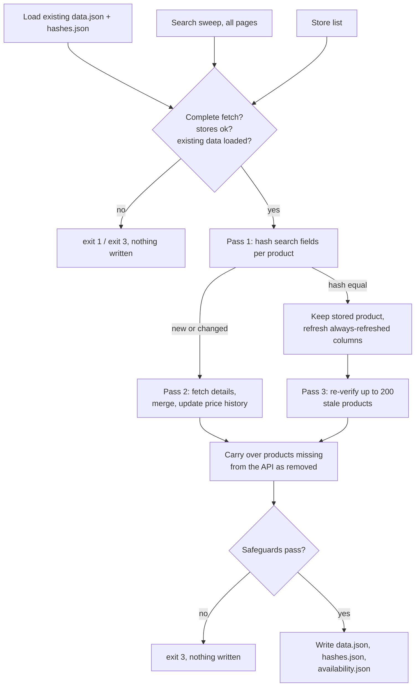

# Sync pipeline

`scripts/data/index.ts` turns Alko's API into `data.json`, `hashes.json` and
`availability.json`. It runs every 6 hours in CI (`fetchData.yml`, see [CI/CD](../ci-cd.md)) and
locally as part of `bun run dev`.

The pure rules it relies on are split out so they can be tested without the network:

| Module                          | Responsibility                                                            |
| ------------------------------- | ------------------------------------------------------------------------- |
| `scripts/data/index.ts`         | HTTP, orchestration, writing files                                        |
| `scripts/data/constants.ts`     | API URLs and headers, the column schema and preprocessors, hashing        |
| `scripts/data/lifecycle.ts`     | Price history, removed flags, merging search + detail payloads, staleness |
| `scripts/data/safeguards.ts`    | Sanity checks that abort a run before it can damage the dataset           |
| `scripts/data/dataset-file.ts`  | Reading/writing `data.json` + `hashes.json`                               |
| `scripts/data/dataset-index.ts` | Builds the precomputed filter `index` on every write                      |
| `scripts/data/types.ts`         | API and dataset types                                                     |

## Alko's API

The sync uses three endpoints on `https://www.alko.fi/api`, all with a Firefox `User-Agent`
(`REQUEST_HEADERS`; requests without one get 403s):

| Endpoint                                   | Used for                                                                                                                         |
| ------------------------------------------ | -------------------------------------------------------------------------------------------------------------------------------- |
| `POST /search/product` `{top, skip, seed}` | The full catalog, 1000 per page, with price, ABV, taste, selection, campaign fields and the list of stores stocking each product |
| `GET /product-api/products/{id}`           | Details for one product: producer, category, grapes, region, vintage, nutrition…                                                 |
| `GET /stores`                              | All outlets with addresses, coordinates and opening hours                                                                        |

The search request must send a fixed **`seed`** (`SEARCH_SEED = 1337`). Without it, paging is
non-deterministic: a full sweep returns only ~7 000–7 700 distinct products padded with duplicates,
even though `@odata.count` reports the full total. That once flagged thousands of live products as
removed.

The full endpoint reference, including endpoints the sync doesn't use, is in
[`notes/alko-api-endpoints.md`](../../notes/alko-api-endpoints.md).

## A sync run

### Loading

`loadSearchProducts`, `loadExistingData` and `loadStores` run in parallel.

- The **search sweep** fetches page 1 alone to learn `@odata.count`, then the remaining pages in
  waves of `ALKO_SEARCH_CONCURRENCY` (default 3) with a 300 ms pause between waves. Products are
  deduplicated by id. The fetch is marked **incomplete** if any page fails after retries or fewer
  products than `@odata.count` came back.
- The **existing dataset** is `data.json` (+ `hashes.json`), falling back to `data-migrated.json`
  from the one-off migration. Rows written under an older, shorter schema are padded to the
  current column count.
- The **store list** must be non-empty, match `totalAmount`, and have unique ids. Pickup points
  (`outletType === "2"`) are dropped.

Requests retry on 403/429 with exponential backoff (1 s doubling, capped at 60 s, plus jitter), up
to `ALKO_MAX_RETRIES` (default 5).

### Abort conditions before any processing

| Condition                                                 | Exit code | Why                                                                                   |
| --------------------------------------------------------- | --------- | ------------------------------------------------------------------------------------- |
| Search fetch incomplete                                   | 1         | A partial list would flag live products as removed                                    |
| Search returned 0 products                                | 1         | Same, for an empty response                                                           |
| Store fetch failed                                        | 1         | Both files are written together; neither is written                                   |
| CI run with no existing products and no `ALKO_SYNC_FORCE` | 3         | The `gh-pages` seed failed. Writing would drop all price history and removed products |

Exit code 1 is retried by the workflow (3 attempts, 60 s apart). Exit code 3 is not retried.

### Change detection

Fetching details for 11 000 products every 6 hours would be slow and hammer Alko's API, so the
sync only fetches details for products whose **search payload** changed.

For each search product, `buildLegacyValues` runs the schema's preprocessors over it, and
`getHash(getHashValues(values))` takes a SHA-256 of the columns marked `usedForHashing`:
`Nimi`, `Hinta`, `Uutuus`, `Luonnehdinta`, `Alkoholi-%`, `Valikoima`, `Normaalihinta`,
`Kampanja alkaa`, `Kampanja päättyy`, `Tila`.

Rules for that set:

- Every hashed field must come from the search API. Otherwise it would be `null` in the first pass
  but filled in the stored hash, and the product would look changed on every run.
- Fields that fluctuate constantly (stock levels, online availability) are not hashed.
- `Tila` is hashed so a status change refetches details. In particular a product that was `Tulee`
  only gets its `pricePerLitre` from the detail API once it's on sale.
- Arrays (only `Luonnehdinta`) are trimmed and sorted before hashing, so Alko returning the same
  taste words in a different order isn't a change.

When the hashed set or a hashed preprocessor changes, bump **`HASH_VERSION`** in
`constants.ts`. `fetchData.yml` runs `scripts/data/rehash.ts` on the seeded dataset before every
sync; it recomputes stored hashes only when the dataset's `HashVersion` differs, so the first run
after a change refetches only products whose data actually differs.

### Pass 1: unchanged products

A product whose hash matches keeps its stored entry, with two adjustments:

- Any `removedFromSelection` flag is cleared (it's in the API again).
- The **always-refreshed columns** (`SEARCH_REFRESHED_COLUMNS`: `Erityisryhmä`,
  `Ruokasuositukset`) are copied from the search payload. They aren't hashed, so a change there
  shouldn't cost a detail fetch, but should still reach the dataset.

### Pass 2: new and changed products

Details are fetched with `ALKO_DETAIL_CONCURRENCY` (default 4, CI 8) in parallel. For each:

1. **Merge** search and detail payloads (`mergeProduct`). Detail keys win, except the campaign
   fields, where the search API's format is canonical: the detail API reports
   `lowest_30d_price` in cents and campaign dates as timestamps.
2. **Build values** with the schema preprocessors.
3. **Protect critical columns.** If the API returns a blank `Numero`, `Nimi`, `Hinta` or `Tyyppi`
   for an existing product, the previous value is kept. A new product missing one is skipped and
   retried next run.
4. **Update price history**: append `{ date, price }` if the price differs from the last point,
   with the campaign fields attached if the product is on sale. A campaign that starts in the
   future is evaluated as of its start date, since nothing re-fetches the product when that day
   comes.
5. Stamp `meta.detailCheckedAt` with today.

If the detail fetch fails, the previous entry is kept unchanged so a transient error never drops a
product.

### Pass 3: re-verify stale details

Detail-only fields (producer, vintage, grapes, region…) can change without touching the search
payload, so pass 1 would never notice. Each run, the products whose `detailCheckedAt` is older
than `ALKO_DETAIL_VERIFY_COOLDOWN_DAYS` (30) are sorted oldest-first and up to
`ALKO_DETAIL_VERIFY_BATCH` (200) are re-fetched. Changed values are written (and price history
updated); either way `detailCheckedAt` is reset. A failed fetch leaves the product eligible for
the next run.

This pass is skipped in `--dev` unless `ALKO_DETAIL_VERIFY_IN_DEV=1`, because the local dataset is
never deployed.

### Removed products

`carryOverMissingProducts` (`lifecycle.ts`) walks the existing dataset after the passes:

- Gifts and drinking accessories, matched by the API's main group or a stored `Tyyppi` of
  "lahja- ja juomatarvikkeet", are dropped.
- A product still in the API response is kept active.
- A product missing from the API that is already flagged keeps its original removal date.
- A product missing from the API that isn't flagged gets `meta.removedFromSelection = today`.

Removed products also get `Uutuus` and `Tila` cleared. This step only runs after a complete fetch, so absence
from the API can be trusted.

### Safeguards

`checkSyncSafety` (`safeguards.ts`) is the last check before writing. It catches an API that
answers successfully with something wrong. The run aborts with exit code 3 if:

| Check                                                                                                          | Limit                                                  |
| -------------------------------------------------------------------------------------------------------------- | ------------------------------------------------------ |
| Products that would disappear from the dataset                                                                 | more than 25                                           |
| Previously active products newly flagged as removed                                                            | more than 10 % (largest real batch so far ~2 %)        |
| A column emptied in rewritten products (excluding `Uutuus` and the campaign columns, which clear legitimately) | more than 50 %, given at least 20 products had a value |
| Relevant API products that list any store                                                                      | fewer than 50 %                                        |

The column check is what catches Alko renaming a field. When a check fails for a real reason (a
large legitimate selection change), re-run the workflow manually with **force** checked, which
sets `ALKO_SYNC_FORCE=1`. See [Operations](../operations.md#forcing-a-sync).

### Writing

- `metadata.LastSynced` is now. `LastUpdated` is now only if something was added, updated, removed
  or dropped; otherwise it carries over.
- `metadata.ci` records `GITHUB_SHA` and the workflow run URL for the sync, and for the update when
  something changed.
- `writeDataset` splits hashes into `hashes.json`, adds a freshly built `index`, and writes removed
  products to `data-removed.json` (see [Dataset format](dataset-format.md)). `readDataset` refuses
  to load a `data.json` whose removed products file is missing, rather than drop their history.
- `availability.json` is rebuilt from scratch: the store map plus every search product's `storeId`
  list, packed into bitmaps (see [Dataset format](dataset-format.md#availabilityjson)).
- With `ALKO_SYNC_REPORT` set, every exit (success, abort or crash) appends one JSON line with the
  attempt's outcome, counts and phase timings (`scripts/data/sync-report.ts`). It ends up in the
  run record, see [Run monitoring](../ci-cd.md#run-monitoring).
- The sync doesn't purge Cloudflare's cache itself. `fetchData.yml` purges the deployed copies after
  its `deploy` job has pushed them (see [CI/CD](../ci-cd.md#fetchdatayml)).

## One-off and maintenance scripts

| Script                    | When to use it                                                                                                                |
| ------------------------- | ----------------------------------------------------------------------------------------------------------------------------- |
| `scripts/data/rehash.ts`  | Runs automatically in CI before each sync. Recomputes hashes when `HASH_VERSION` changed, and pads rows to the current schema |
| `scripts/data/migrate.ts` | Historical. Converted the legacy XLSX-based `{ table, metadata }` dataset into the current format                             |
| `scripts/data/cleanup.ts` | Historical. Removed gifts and accessories from `data-migrated.json`                                                           |

[`notes/migration.md`](../../notes/migration.md), [`notes/fixes.md`](../../notes/fixes.md) and
[`notes/improvements.md`](../../notes/improvements.md) document how the sync got to its current
shape.
